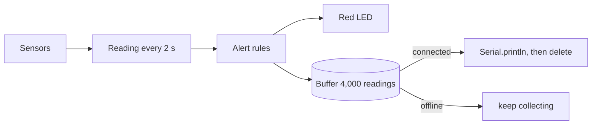

# Edge Computing: local storage and offline resilience

Code: [`iot/esp32-edge/sketch.ino`](../../iot/esp32-edge/sketch.ino)

## Overview

The ESP32 simulates a cardiac wearable that keeps working without network. Each reading is checked and stored on
the device first and only then sent to the cloud. If the connection drops, nothing is lost and the local alarm
keeps working.

## Hardware

| Component | Pin | Role |
|---|---|---|
| DHT22 | GPIO15 | body temperature and skin humidity |
| Push button (key `B`) | GPIO4 | pulse sensor: each press is a heartbeat; BPM = 60,000 / mean interval of the last 4 beats |
| Potentiometer | GPIO34 | simulated heart rate (40–180 bpm) used while the button is idle |
| MPU6050 | GPIO21/22 (I²C) | movement, time without moving and falls (impact above 2.5 g) |
| Slide switch | GPIO27 | simulated Wi-Fi (`wifiConnected`): right = connected, left = offline |
| Green / red LED | GPIO25 / GPIO26 | online / alert |

## Operating flow

The main loop does not use `delay()`. On each pass it:

1. Reads the button with debounce. Presses less than 250 ms apart are ignored, and a pause longer than 2 s starts a new measurement.
2. Reads the switch and logs connection changes.
3. Every 100 ms, reads the accelerometer to detect movement and impact.
4. Every 2 s, creates a reading with:
   - temperature and humidity;
   - BPM (from the button, or from the potentiometer while the button is idle);
   - the movement flag and the time without movement.
5. Checks the limits on the device and turns on the red LED, with or without network:
   - tachycardia: above 120 bpm;
   - bradycardia: below 50 bpm;
   - fever: 38 °C or more;
   - hypothermia: below 35 °C;
   - possible fall.
6. Stores the reading in the buffer.
7. If connected, sends up to 20 readings per pass, oldest first, as `CLOUD> {json}` lines on the Serial Monitor, and removes them from the buffer. When the buffer is empty it prints `[SYNC] N readings sent, local buffer cleared`.

Typing `s` in the Serial Monitor prints the buffer statistics.

## Resilience logic

- **Store and forward.** Every reading goes to the buffer before being sent. The same code handles one reading or a backlog of thousands.
- **Remove after sending.** A reading only leaves the buffer after it has been sent.
- **No clock on the ESP32.** Each record keeps the `millis()` of its capture, and the JSON carries `age_s` (seconds since capture). The receiver computes the real time as `now - age_s`.
- **Sequence number.** `seq` allows the cloud to detect gaps and duplicates.
- **Local alarm.** Alerts do not depend on the network.

## Storage strategy

Each reading uses 16 bytes:

- the sequence number and the capture time;
- temperature ×10 and humidity ×10;
- seconds without movement and the BPM;
- one status byte with 5 alert bits and 3 flags.

The buffer holds 4,000 readings, or 64 KB of RAM. At one reading every 2 s, that is about 2 h 13 min at full resolution.

The target use is home monitoring after hospital discharge. Typical outages there are a Wi-Fi drop, the router
turned off at night, or the patient leaving home. We sized the solution to keep a full day (24 h) offline. Storing a
full day at full resolution would need 691 KB (43,200 × 16 bytes), more than the free RAM of the ESP32 (~320 KB,
shared with Wi-Fi).

When the buffer fills up:

1. All readings with an alert are kept, together with one of every two normal readings.
2. From then on, only 1 of every 2 normal readings is stored, then 1 of 4, 1 of 8, and so on. Every reading is still checked for alerts, and alerts are always stored.
3. After the backlog is sent, storage returns to full resolution.

The whole outage stays covered, from the first to the last minute, at a lower resolution. A Python simulation
of the same algorithm gave:

| Outage | Readings measured | Kept | Stored resolution | Alerts kept |
|---|---|---|---|---|
| 2 h 13 min @ 2 s | 4,000 | 4,000 | 2 s | all |
| 12 h @ 2 s | 21,600 | 2,701 | 14–16 s | all |
| 24 h @ 2 s | 43,200 | 2,701 | 30–32 s | all |
| 24 h @ 5 s | 17,280 | 2,161 | 35–40 s | all |

A simple FIFO that drops the oldest readings would lose the start of the outage, which is often when the
patient's condition changed.

**SPIFFS.** With `USE_SPIFFS 1`, each reading is also written to `/buffer.csv` (~32 bytes per line, ~128 KB
for 4,000 lines). After a reboot, unsent readings are reloaded. The file is rewritten after a compaction and
deleted after a complete sync. This option only works on a physical ESP32. In Wokwi the file system is lost
when the simulation stops, so the Serial Monitor works as the offline log.

## Testing in Wokwi

1. Start the simulation. With the switch on the right, each reading shows `[EDGE] ... stored` followed by `CLOUD> {...}`.
2. Move the switch to the left. The log shows `[NET] Wi-Fi lost`, the green LED turns off and the buffer grows.
3. Set the DHT22 above 38 °C or turn the potentiometer up. The red LED and `[ALERT]` appear even offline.
4. Move the switch to the right. The buffered readings are sent in order (`age_s` shows their age), followed by `[SYNC]`.
5. To see the full-buffer behavior quickly, set `BUFFER_CAPACITY` to 20.

## Limitations

- The heart rate comes from a button and a potentiometer, not from a PPG or ECG sensor.
- The RAM buffer is lost if the battery runs out; only the SPIFFS option survives a reboot.
- The alert limits are fixed. A real device would use limits set for each patient.
