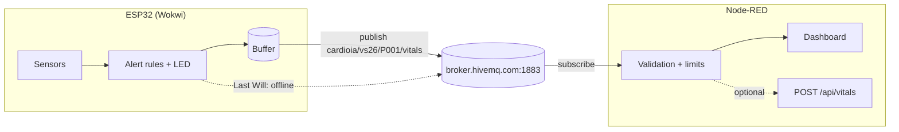
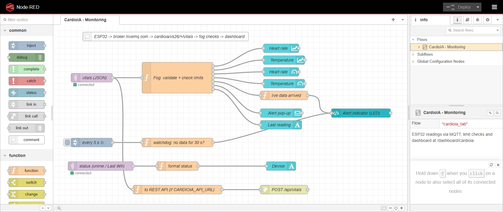
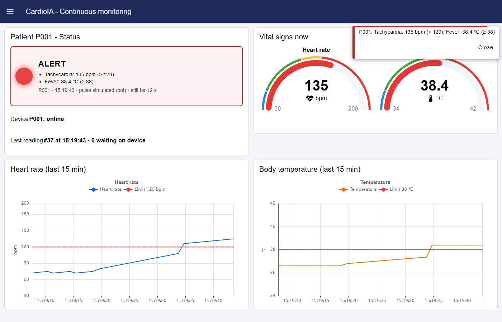
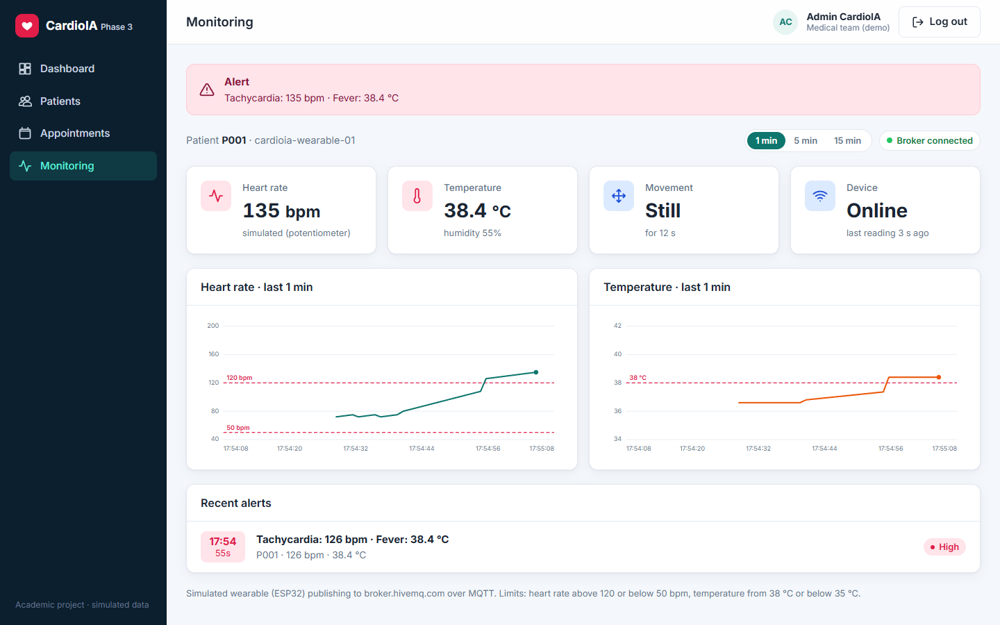

# MQTT communication and Node-RED dashboard

Code: [`iot/esp32-mqtt/sketch.ino`](../../iot/esp32-mqtt/sketch.ino) · Flow: [`iot/node-red/flows.json`](../../iot/node-red/flows.json)

## Architecture



- **ESP32 (edge):** measures, applies the first alert rules and buffers readings while offline, as described in [edge_computing.md](edge_computing.md).
- **Broker (cloud):** routes the messages.
- **Node-RED (fog):** validates the data, checks the limits again, rebuilds the timeline and displays it.

The limits are checked twice. The device can alert without network, and Node-RED is the place where the limits
can be changed without updating the firmware.

## MQTT

MQTT is a publish/subscribe protocol. Clients publish messages to topics on a broker, and the broker delivers them
to every client subscribed to those topics. It uses one TCP connection kept alive with small ping packets and a
2-byte minimum header, which suits small devices.

### Topics

| Topic | Direction | Payload | Options |
|---|---|---|---|
| `cardioia/vs26/P001/vitals` | ESP32 → Node-RED | JSON reading | QoS 0 |
| `cardioia/vs26/P001/status` | ESP32 → Node-RED | `online` / `offline` | QoS 1, retained, Last Will |

`cardioia/vs26` is the project prefix and `P001` is a pseudonymous patient ID. Node-RED subscribes to
`cardioia/vs26/+/vitals`, so new patients appear without changing the flow.

### Payload

```json
{"device":"cardioia-wearable-01","patient":"P001","seq":128,"age_s":0,"bpm":134,
 "bpm_source":"simulated","temp_c":38.4,"humidity":55.0,"moving":false,"still_s":42,
 "alerts":["TACHYCARDIA","FEVER"],"buffered":0}
```

| Field | Meaning |
|---|---|
| `seq` | sequence number of the reading |
| `age_s` | seconds since capture (0 for live readings) |
| `bpm`, `bpm_source` | heart rate and its source (button or potentiometer) |
| `temp_c`, `humidity` | DHT22 values (`null` on sensor error) |
| `moving`, `still_s` | movement in the last 2 s and seconds without movement |
| `alerts` | alerts detected on the device (`FALL` is only detected there) |
| `buffered` | readings still waiting on the device |

The JSON is built with `snprintf`. The PubSubClient buffer was increased from 256 to 512 bytes because the
message has about 250 bytes.

### Connection on the ESP32

The connection is managed without blocking the loop:

1. **Wi-Fi.** `WiFi.begin("Wokwi-GUEST", "", 6)`, retried every 15 s.
2. **MQTT.** `mqtt.connect(clientId, statusTopic, 1, true, "offline")`, retried every 5 s. The client ID uses the end of the MAC address.
3. **After connecting.** Publishes `online` (retained) and sends the buffer.
4. **While connected.** `mqtt.loop()` keeps the session alive (keepalive 15 s).
5. **Sending.** Readings are published oldest first, 10 per loop pass. A reading is removed from the buffer only after `publish()` succeeds.

**Simulated loss of coverage.** Moving the switch to the left calls `WiFi.disconnect()` and closes the socket without an
MQTT DISCONNECT. Without pings, the broker considers the client lost after about 22 s (1.5 × keepalive) and
publishes its Last Will (`offline`), which appears on the dashboard. The ESP32 keeps measuring and storing. When
the switch returns, it reconnects and publishes the backlog. Node-RED places each reading at `now - age_s`, filling the
gap in the charts.

**QoS.** PubSubClient publishes only with QoS 0. A successful `publish()` means the data was handed to TCP, not
that the broker confirmed it. QoS 1 would need another library (such as ESP-IDF `esp-mqtt`), removing the
reading only after the PUBACK. Duplicates would then be filtered by `seq`, as the REST API already does.

## Node-RED flow

Tested with Node-RED 4.1 and `@flowfuse/node-red-dashboard` 1.35 (Dashboard 2.0).



| Node | Function |
|---|---|
| `mqtt in` vitals | subscribes to `cardioia/vs26/+/vitals` and parses the JSON |
| `function` Fog: validate + check limits | discards invalid values (BPM outside 20–250, temperature outside 25–45 °C), computes the capture time, classifies the reading and sends each value to its widget (7 outputs) |
| `mqtt in` status → format status | shows `online` or `OFFLINE (connection lost)` |
| `inject` 5 s → watchdog | turns the indicator grey when no live reading arrives for 30 s |
| to REST API → `http request` | forwards each reading to `POST /api/vitals` when `CARDIOIA_API_URL` is set |

Limits:

| Parameter | Attention | Alert |
|---|---|---|
| Heart rate | 101–120 bpm | above 120 or below 50 bpm |
| Temperature | 37.5–37.9 °C | 38.0 °C or more, or below 35.0 °C |
| Movement | — | `FALL` from the accelerometer |

**Live and buffered readings.** Readings with `age_s` up to 10 s are live. They update the gauges, the indicator and
the text fields. Older readings came from the device buffer and only go to the charts, at their capture
time. If one of them has an alert, a notification says it was recorded while offline. The pop-up is shown only when
the set of problems changes, not on every reading.

## Dashboard

Address: `http://localhost:1880/dashboard/cardioia`

| Group | Widget | Configuration |
|---|---|---|
| Status | Alert indicator (`ui-template`) | green normal, yellow attention, blinking red alert, grey no data; shows the reasons, time, pulse source and movement |
| | Device / Last reading (`ui-text`) | broker status and last sequence number |
| Vital signs now | Heart rate gauge | 30–200 bpm; blue < 50, green 50–100, yellow 100–120, red > 120 |
| | Temperature gauge | 34–42 °C; blue < 35, green 35–37.5, yellow 37.5–38, red ≥ 38 |
| Heart rate (15 min) | Line chart | heart rate and a 120 bpm limit line; x = capture time |
| Body temperature (15 min) | Line chart | temperature and a 38 °C limit line |
| Page | Notification (`ui-notification`) | red, 8 s |



The screenshot shows normal readings, then 15 s recorded offline and received later (the gradual rise), then live
tachycardia with fever.

**Setup:**
1. Install Node-RED.
2. In *Manage palette*, install `@flowfuse/node-red-dashboard`.
3. Import `iot/node-red/flows.json` and click *Deploy*.

## Portal monitoring page

The React portal (`apps/portal/`, page `/monitoring`) also subscribes to the same topics. It connects directly from
the browser to `wss://broker.hivemq.com:8884/mqtt` (MQTT over WebSocket) with the `mqtt` library and applies the same
limits. It shows:

- an alert banner;
- cards for heart rate, temperature, movement and device status;
- charts for the last 1, 5 or 15 minutes, with limit lines;
- the list of recent alerts, one entry per episode.

The broker address and topic prefix can be changed with `VITE_MQTT_URL` and `VITE_MQTT_TOPIC_ROOT`.



## Tests

- **Firmware.** Both sketches compile with PlatformIO (`espressif32 6.9.0`, `-Wall`) without warnings. The MQTT version uses 13.9% of static RAM and 59% of flash.
- **Flow and dashboard.** The flow was loaded in Node-RED 4.1.17 and connected to `broker.hivemq.com`. A script published messages in the same format as the ESP32: 12 normal readings, status `offline`, 15 readings held back, status `online`, those 15 readings with their real `age_s`, and 10 readings with tachycardia and fever. The dashboard behaved as expected.
- **REST forwarding.** With `CARDIOIA_API_URL` set, the readings reached the REST API, which generated the alert e-mail.

## Security

The public broker was used because it works in Wokwi without configuration. It has no encryption or
authentication, so anyone subscribing to `cardioia/#` can read the data or publish false readings. A production
setup would need:

1. **Encryption.** TLS on port 8883, for example with HiveMQ Cloud. On the ESP32 this means `WiFiClientSecure` with the broker's CA certificate; in Node-RED, the TLS option of the broker node.
2. **Access control.** Credentials or a certificate per device, plus ACLs so that each wearable publishes only to its own topic. Credentials stay out of the repository.
3. **Privacy (LGPD).** Only a pseudonymous ID travels, with the minimum data needed, a defined retention period and access logs.
4. **Reliability.** QoS 1 with deduplication by `seq`, the Last Will and a watchdog for missing data, and validation of every payload in the fog layer.
5. **Device.** Signed OTA updates, and the serial console disabled in production.

## Not included

- Grafana was not used. It could be added by writing the readings to InfluxDB from Node-RED and building the panels in Grafana.
- The dashboard has no authentication (Node-RED `adminAuth` and HTTPS would be needed outside a lab).
