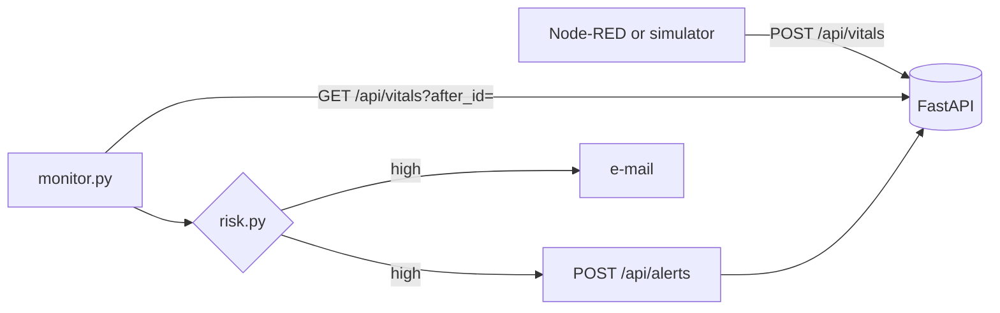

# REST API, risk detection and e-mail alerts

Code: [`src/monitoring/`](../../src/monitoring/)

## Overview

A Python service receives vital signs through a REST API. A monitor reads the new data from the same API,
evaluates the risk of each patient, sends an e-mail when the risk is high and records the alert in the API.



| File | Role |
|---|---|
| `api.py` | FastAPI server with Pydantic validation, in-memory storage and duplicate detection by `(device_id, seq)` |
| `client.py` | REST client with timeout and retries |
| `risk.py` | risk rules |
| `notifier.py` | e-mail by SMTP, or `.eml` file when SMTP is not configured |
| `monitor.py` | polling, evaluation, notification and alert record |
| `simulator.py` | five simulated patients |
| `run_demo.py` | runs the whole flow |

## API

| Route | Use |
|---|---|
| `GET /api/health` | service status |
| `POST /api/vitals` | stores a reading: `201 {"id": 17, "duplicate": false}`; invalid data returns `422` |
| `GET /api/vitals?after_id=&patient_id=&limit=` | readings after a given id |
| `GET /api/patients`, `GET /api/patients/{id}/latest` | latest reading per patient (`404` if none) |
| `POST /api/alerts`, `GET /api/alerts` | alert history |

Values outside the valid range are rejected before reaching the rules: BPM outside 20–250, or temperature outside
25–45 °C. The OpenAPI documentation is available at `/docs`.

## Risk rules

The rules use the same limits as the ESP32 and Node-RED, applied to the patient's recent history.

| Code | Attention | High risk |
|---|---|---|
| `TACHYCARDIA` | above 120 bpm once | above 120 bpm in 2 consecutive readings, or 150 bpm or more |
| `BRADYCARDIA` | below 50 bpm once | below 50 bpm in 2 consecutive readings, or 40 bpm or less |
| `ELEVATED_HR` | 101–120 bpm | — |
| `FEVER` / `LOW_GRADE_FEVER` | 37.5–37.9 °C, or 38 °C or more once | 38 °C or more in 2 consecutive readings, or 39.5 °C or more |
| `HYPOTHERMIA` | below 35 °C once | below 35 °C in 2 consecutive readings |
| `NO_MOVEMENT` | 30 min or more without movement | 30 min or more without movement with abnormal heart rate |
| `FALL` | — | impact detected by the accelerometer |

A single abnormal value may be sensor noise, so most conditions must repeat before an e-mail is sent. Lying still
alone is normal during sleep, so it only becomes high risk together with an abnormal heart rate.

## E-mail

- **SMTP.** Real sending uses STARTTLS when `SMTP_HOST`, `SMTP_USER` and `SMTP_PASSWORD` are set; `SMTP_PORT` and `ALERT_EMAIL_TO` are optional. Gmail works with an app password.
- **Without SMTP.** The message is saved in `results/monitoring/outbox/` as a `.eml` file.
- **Content.** Subject example: `[CardioIA] HIGH RISK - patient P004: BRADYCARDIA, NO_MOVEMENT`. The body has the findings, vital signs, capture time and a suggested action, in plain text and HTML.
- **When it is sent.** A new e-mail is sent when the set of problems changes, or after 10 minutes if the same problem continues. When the patient returns to normal, the next episode alerts again.

## Results

`uv run python src/monitoring/run_demo.py` sends 200 readings (40 per patient, one per minute):

| Patient | Scenario | Result |
|---|---|---|
| P001 | normal, with one isolated reading of 126 bpm | 1 attention event, no e-mail |
| P002 | heart rate above 120 bpm | `TACHYCARDIA` e-mail and a reminder after 10 min |
| P003 | temperature rising to 38.8 °C | `FEVER` e-mail and a reminder after 10 min |
| P004 | no movement, then heart rate down to 41 bpm | `NO_MOVEMENT` (31 min still at 48 bpm), then `BRADYCARDIA, NO_MOVEMENT` |
| P005 | fall, then lying still | immediate `FALL` e-mail |

In total, 7 e-mails were generated and 7 alerts recorded. A repeated reading was detected as a duplicate. The
summary is saved in `results/monitoring/demo_summary.json`.

With the API on port 8000 and Node-RED started with `CARDIOIA_API_URL=http://127.0.0.1:8000`, readings published
over MQTT reached the API through the Node-RED flow, and the monitor generated the alert e-mail. Node-RED sends the
requests concurrently, so readings may arrive out of order. For that reason the monitor sorts each batch by capture
time before evaluating it.

## How to run

```bash
uv run python src/monitoring/run_demo.py              # complete demo

uv run python src/monitoring/api.py                   # API on port 8000
uv run python src/monitoring/simulator.py             # sends the simulated patients
uv run python src/monitoring/monitor.py --interval 5  # continuous monitoring
```

## Limitations

- In-memory storage: data is lost when the API restarts.
- No authentication on the API.
- The monitor uses polling. A webhook or a queue would react faster.
- Fixed limits. They should be adjusted for each patient by the physician.
